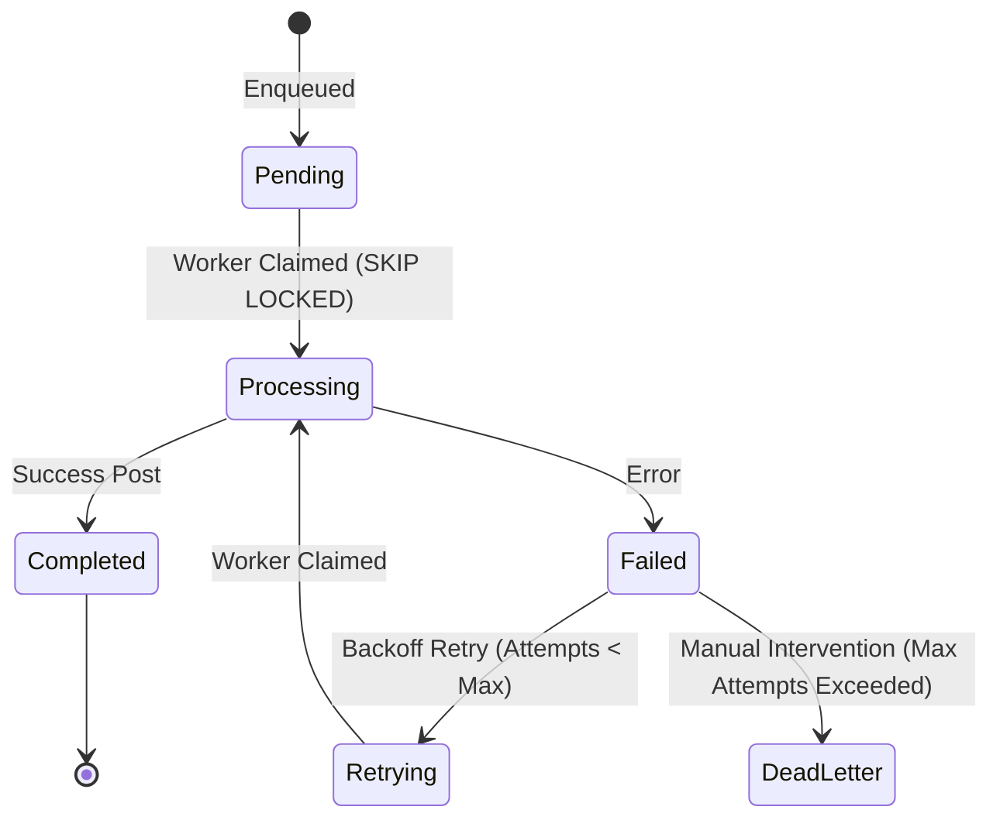

# Design & Architecture Guide: Responsive Data Tables, Pagination & Long Queue Systems

## 1. Executive Summary & Purpose

In retail, point-of-sale (POS), warehouse logistics, and accounting platforms like **AR Option**, data tables range from small, interactive operational lists to high-volume queues processing tens of thousands of parcels, ledger lines, and stock transfers.

This specification establishes the standardized architecture, UX requirements, performance patterns, and implementation recipes for **Data Tables, Pagination Control Systems, and Long Queue Processing**. 

Whenever a new feature involves high-density data, tabular views, or background work queues, developers must consult and follow this document.

---

## 2. Decision Matrix: Choosing the Right Data Loading Strategy

Not all tables behave the same way. Choosing the wrong pagination or scrolling strategy leads to performance degradation, phantom data reads, or audit violations.

```
                                  Dataset Size & Nature
                                            |
            +-------------------------------+-------------------------------+
            |                                                               |
     Small / Medium                                                 Large / Growing Fast
   (< 1,000 records)                                                (> 1,000 to Millions)
            |                                                               |
    Client-side Cache                                                       |
   (Full Fetch + In-Memory)                        +------------------------+------------------------+
   - Fast instant search                           |                                                 |
   - Instant sorting                               |                                                 |
   - Client Pagination                     Auditable / Financial                     Active Operational Queues
                                           - General Ledger                          - Courier Parcel Dispatch
                                           - Trial Balance                           - POS Sync / Offline Queue
                                           - Cash Reconciliation                     - Stock Transfer Processing
                                                   |                                                 |
                                         Server-Side Offset                         Server-Side Keyset / Cursor
                                         (LIMIT / OFFSET)                           (WHERE id > :cursor LIMIT)
                                         - Exact page numbers                       - Immune to offset degradation
                                         - "Showing 26–50 of 250"                   - Immune to row drift on writes
                                         - Immutable audit trail                    - High-throughput worker queues
```

| Strategy | Best Suited For | Scale Limit | Total Count Available? | Shift / Drift Resilient? | Implementation |
| :--- | :--- | :--- | :--- | :--- | :--- |
| **Client-Side Pagination** | Small lists (< 1,000 rows): Users, Category lists, Active shops | Up to ~2,000 items | Yes (exact) | Yes (local snapshot) | `<Pagination />` with client `.slice()` |
| **Server-Side Offset Pagination** | Auditable business records: Daily expenses, Trial balances, Invoices | Up to ~100,000 rows | Yes (`COUNT(*)`) | Moderate (shifts on new inserts) | `LIMIT :pageSize OFFSET :offset` |
| **Server-Side Keyset (Cursor)** | High-throughput long queues: Parcel dispatch, Stock ledger log, Event stream | Millions of rows | Optional / Estimated | High (zero drift on new inserts) | `WHERE (created_at, id) < (:cursor_date, :cursor_id)` |
| **Virtual Scrolling (DOM)** | Ultra-dense views: Matrix price grids, POS live ticket itemization | Infinite within screen | N/A | High | Windowed rendering (e.g., TanStack Virtual) |

> [!IMPORTANT]
> **The Golden Rule of Auditing**: Financial statements, cash closings, and ledger journals **must never use infinite scroll**. Auditable records require deterministic page boundaries with explicit stats ("Showing X–Y of Z") so accountants and auditors can cross-reference physical printouts and ledger references.

---

## 3. The Pagination Control System Specification

The application uses a unified, modular Pagination Control System built in React with Tailwind CSS, located at:
`apps/web/src/components/pagination/`

### 3.1 Component Architecture

The pagination system is partitioned into modular, independently testable units:

```
apps/web/src/components/pagination/
├── types.ts              # TypeScript interfaces and contracts
├── usePagination.ts       # Custom hook for pagination math & smart truncation
├── PaginationStats.tsx   # Accessible "Showing 26–50 of 250 items" display
├── PageSizeSelector.tsx  # Dropdown [10, 25, 50, 100] with page 1 reset
├── PaginationNav.tsx     # Previous, smart truncated numbers, Next
├── Pagination.tsx        # Unified responsive container
├── DataTableExample.tsx  # Interactive reference implementation
└── index.ts              # Public barrel exports
```

### 3.2 Props Interface

```typescript
export interface PaginationProps {
  /** Total number of items across all pages */
  totalItems: number;
  /** Active 1-based page index */
  currentPage: number;
  /** Items per page (defaults to 25) */
  pageSize: number;
  /** Callback fired when user selects a new page */
  onPageChange: (page: number) => void;
  /** Callback fired when user selects a new page size */
  onPageSizeChange: (size: number) => void;
  /** Available page sizes (defaults to [10, 25, 50, 100]) */
  pageSizeOptions?: number[];
  /** Sibling page count beside current page (default: 1) */
  siblingCount?: number;
  /** Boundary page count at start and end (default: 1) */
  boundaryCount?: number;
  /** Disable all interactive elements during network loading */
  disabled?: boolean;
  /** Show stats text "Showing X–Y of Z items" (default: true) */
  showStats?: boolean;
  /** Show rows per page dropdown (default: true) */
  showPageSizeSelector?: boolean;
  /** Show quick jump to first/last buttons (default: false) */
  showQuickJump?: boolean;
  /** Custom singular noun for items (default: "item") */
  itemLabel?: string;
  /** Custom plural noun for items (default: "items") */
  itemLabelPlural?: string;
  /** Custom styling overrides */
  className?: string;
}
```

### 3.3 Core Functional Requirements

1. **Page Size Selector (Rows Per Page)**:
   - Dropdown with options: `[10, 25, 50, 100]`. Defaults to `25`.
   - Changing the page size **recalculates the total pages** and **immediately resets `currentPage` to 1**.
   - Accessible label linked via `htmlFor` with semantic `<select>` styling.
2. **Pagination Navigation & Smart Truncation**:
   - Displays **Previous**, smart truncated page numbers, and **Next**.
   - **Disables Previous** on page 1 (or when `totalItems === 0`).
   - **Disables Next** on the final page (`currentPage >= totalPages` or `totalItems === 0`).
   - **Truncation Algorithm Rules**:
     - When `totalPages <= 7`: display all numbers `[1, 2, 3, 4, 5, 6, 7]`.
     - When `totalPages > 7` and near start: `[1, 2, 3, 4, 5, '...', totalPages]`.
     - When `totalPages > 7` and in middle: `[1, '...', currentPage - 1, currentPage, currentPage + 1, '...', totalPages]`.
     - When `totalPages > 7` and near end: `[1, '...', totalPages - 4, totalPages - 3, totalPages - 2, totalPages - 1, totalPages]` (e.g. `1, 2, ... 8, 9, 10`).
3. **Display Stats**:
   - Formatted as `'Showing 26–50 of 250 items'` with `tabular-nums` for stable font rendering.
   - Edge case 0 items: `'Showing 0 of 0 items'`.
   - Edge case 1 item: `'Showing 1 of 1 item'`.
4. **Accessibility (a11y)**:
   - `<nav role="navigation" aria-label="Pagination Navigation">`.
   - Active page has `aria-current="page"`.
   - Clear `aria-label` for screen readers on every interactive element.
   - High-contrast visible focus rings (`focus-visible:ring-2 focus-visible:ring-primary`).

---

## 4. Handling Long Queues & High-Throughput Data Tables

When tables represent **active processing queues** (e.g. Courier Parcel Dispatch, Batch Product Import, Offline POS Sync Backlog), specific architectural challenges arise:

### 4.1 Queue State Machine

All long queues must follow an explicit status lifecycle:



### 4.2 Preventing Concurrency Collisions & Double-Processing

When multiple workers or users process queue items simultaneously:

```sql
-- Pattern: Safe Queue Claiming in PostgreSQL
WITH next_item AS (
  SELECT id
  FROM courier_parcels_queue
  WHERE status = 'pending'
    AND shop_id = :shop_id
  ORDER BY created_at ASC
  LIMIT :batch_size
  FOR UPDATE SKIP LOCKED
)
UPDATE courier_parcels_queue
SET status = 'processing',
    locked_at = NOW(),
    locked_by = :worker_id
FROM next_item
WHERE courier_parcels_queue.id = next_item.id
RETURNING courier_parcels_queue.*;
```

`FOR UPDATE SKIP LOCKED` guarantees that no two workers ever claim the same parcel or transaction, completely eliminating lock contention and duplicate dispatches.

### 4.3 Preventing "Page Drift" on Fast-Moving Queues

#### The Problem:
When new parcels or orders are inserted at the top of a queue while a user is browsing page 2, standard `LIMIT 25 OFFSET 25` shifts rows downward. The user sees duplicate rows or misses items that slipped between pages.

#### Solutions:
1. **Cursor / Keyset Pagination for Queues**:
   Instead of `OFFSET 50`, query relative to the last seen item ID and timestamp:
   ```sql
   SELECT *
   FROM parcels_queue
   WHERE shop_id = :shop_id
     AND (created_at, id) < (:last_seen_created_at, :last_seen_id)
   ORDER BY created_at DESC, id DESC
   LIMIT :pageSize;
   ```
2. **Snapshot Timestamp Pinning**:
   When the user opens the queue, stamp a session parameter `snapshot_at = NOW()`. Subsequent page turns query `WHERE created_at <= :snapshot_at`.
   - Display a floating banner if new items arrive: *"12 new parcels added to queue. [Refresh List]"*.
   - This keeps the user's view stable while processing.

### 4.4 Large Dataset Count Optimization

On PostgreSQL tables exceeding 100,000 rows, `SELECT COUNT(*)` requires a sequential scan that can take hundreds of milliseconds.

```sql
-- Solution 1: Fast estimated count for non-audited tables
SELECT reltuples::BIGINT AS estimated_total
FROM pg_class
WHERE relname = 'courier_parcels_queue';

-- Solution 2: Exact count per shop using compound indexed count
SELECT COUNT(id)
FROM courier_parcels_queue
WHERE shop_id = :shop_id AND status = 'pending';
-- Requires INDEX idx_queue_shop_status ON courier_parcels_queue(shop_id, status);
```

---

## 5. Responsive UX Standards for Data Tables

Tables in AR Option run on hardware from low-cost Android smartphones (320px width) up to 4K desktop displays.

### 5.1 Device Adaptation Rules

| Device Class | Screen Width | Operational Lists (Parcels, Expenses, Products) | Financial Tables (Ledgers, Balance Sheet) |
| :--- | :--- | :--- | :--- |
| **Phone** | `< 744px` | **Card Transformation**: Each row renders as a clean card showing key fields, status badge, and primary action. Tapping opens detail sheet. Checkboxes hidden until "Select" button pressed. | **Horizontal Scroll Container**: All columns remain visible with sticky first column (Ref/Date), edge shadows, and minimum touch target size. |
| **Tablet** | `744px – 1023px` | **Condensed Table**: Secondary columns hidden or combined (e.g. City + Customer in one cell). Touch targets at least 44px. | **Full Table with Horizontal Scroll**: Sticky headers, tabular figures. |
| **Desktop** | `>= 1024px` | **Full Data Table**: All columns displayed, sortable column headers, multi-row bulk actions bar, column density options. | **Full Financial Ledger**: Double-entry balance verification, export actions. |

### 5.2 Layout Stability & Skeleton Loading

Never allow the table container to collapse to 0px height during page transitions:
1. Preserve minimum container height (`min-h-[400px]`).
2. Render skeleton placeholder rows during fetching instead of removing table elements.
3. Keep the pagination controls in place during network fetches with `disabled={true}`.

### 5.3 URL State Synchronization

All table state (page, page size, search filters, and sorting) should be synchronized to URL search parameters:
`https://app.aroption.com/courier?tab=queue&page=2&pageSize=50&status=pending&sort=date_desc`

**Benefits**:
- Users can reload without losing their position in a 500-item queue.
- Support for browser Back and Forward navigation buttons.
- Multi-window workflows: staff can open multiple queue pages in separate tabs.

---

## 6. Database Indexing Guide for High-Scale Tables

Every table featuring pagination and filtering must have proper compound B-Tree indexes matching query filters:

```sql
-- 1. Multi-shop filtering with date sorting (Rule 1 Enforcement)
CREATE INDEX idx_expenses_shop_created 
ON expenses (shop_id, created_at DESC);

-- 2. Queue processing by shop and status
CREATE INDEX idx_queue_shop_status_created 
ON courier_parcels_queue (shop_id, status, created_at ASC);

-- 3. Product catalog search with SKU indexing
CREATE INDEX idx_products_shop_sku 
ON products (shop_id, sku);

CREATE INDEX idx_products_name_trgm 
ON products USING gin (name gin_trgm_ops);
```

---

## 7. Developer Implementation Recipes

### Recipe 1: Client-Side Paginated Table

Use this pattern when total items are fetched once (< 1,000 items):

```tsx
import React, { useState, useMemo } from 'react';
import { Pagination } from '@/components/pagination';

export const ClientTableExample: React.FC<{ data: MyItem[] }> = ({ data }) => {
  const [currentPage, setCurrentPage] = useState<number>(1);
  const [pageSize, setPageSize] = useState<number>(25);

  // Calculate slice for current page
  const paginatedData = useMemo(() => {
    const start = (currentPage - 1) * pageSize;
    return data.slice(start, start + pageSize);
  }, [data, currentPage, pageSize]);

  return (
    <div className="bg-light-surface dark:bg-dark-surface rounded-2xl border border-light-border dark:border-dark-border overflow-hidden">
      <table className="w-full text-xs">
        {/* Table headers and rows mapping paginatedData */}
      </table>

      <Pagination
        totalItems={data.length}
        currentPage={currentPage}
        pageSize={pageSize}
        onPageChange={setCurrentPage}
        onPageSizeChange={setPageSize}
        pageSizeOptions={[10, 25, 50, 100]}
        itemLabel="record"
        itemLabelPlural="records"
      />
    </div>
  );
};
```

---

### Recipe 2: Server-Side Paginated Table with URL Sync

Use this pattern for large tables and financial ledgers:

```tsx
import React, { useState, useEffect, useCallback } from 'react';
import { Pagination } from '@/components/pagination';
import { apiFetch } from '@/lib/api';

export const ServerTableExample: React.FC = () => {
  const [items, setItems] = useState<any[]>([]);
  const [totalItems, setTotalItems] = useState<number>(0);
  const [currentPage, setCurrentPage] = useState<number>(1);
  const [pageSize, setPageSize] = useState<number>(25);
  const [loading, setLoading] = useState<boolean>(false);

  const fetchData = useCallback(async () => {
    setLoading(true);
    try {
      const res = await apiFetch(`/api/records?page=${currentPage}&pageSize=${pageSize}`);
      const json = await res.json();
      setItems(json.items);
      setTotalItems(json.meta.totalItems);
    } finally {
      setLoading(false);
    }
  }, [currentPage, pageSize]);

  useEffect(() => {
    fetchData();
  }, [fetchData]);

  return (
    <div className="bg-light-surface dark:bg-dark-surface rounded-2xl border border-light-border dark:border-dark-border overflow-hidden">
      {/* Table rows */}
      <Pagination
        totalItems={totalItems}
        currentPage={currentPage}
        pageSize={pageSize}
        onPageChange={setCurrentPage}
        onPageSizeChange={setPageSize}
        disabled={loading}
        itemLabel="transaction"
        itemLabelPlural="transactions"
      />
    </div>
  );
};
```

---

## 8. Implementation Checklist for New Data Tables

Before merging any feature containing a data table or long queue:

- [ ] **Strategy Selected**: Is the decision between client-side, server-side offset, or cursor pagination explicit?
- [ ] **Pagination Control System**: Are rows-per-page options set to `[10, 25, 50, 100]` with default `25`?
- [ ] **Page 1 Reset**: Does changing the page size reset `currentPage` to 1?
- [ ] **Smart Truncation**: Does the table display Previous, Next, and smart truncated page numbers (`1, 2, ... 8, 9, 10`)?
- [ ] **Accessible Button States**: Are `aria-label`, `aria-current="page"`, and `disabled` attributes present?
- [ ] **Display Stats**: Does it render "Showing X–Y of Z items" with tabular figures?
- [ ] **Edge Cases Covered**: Does the table render cleanly with 0 items, 1 item, and > 1,000 items?
- [ ] **Responsive Design Verified**:
  - [ ] Phone (< 744px): Card view or sticky horizontal scroll.
  - [ ] Tablet (744px–1023px): Touch-friendly padding (>= 44px).
  - [ ] Desktop (>= 1024px): Full multi-column view with hover states.
- [ ] **Queue Safety**: If it is an operational queue, are concurrency collisions prevented with `SKIP LOCKED` or cursor snapshots?
- [ ] **Database Indexes**: Are foreign keys (`shop_id`), status columns, and timestamp sorting columns indexed?
